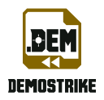
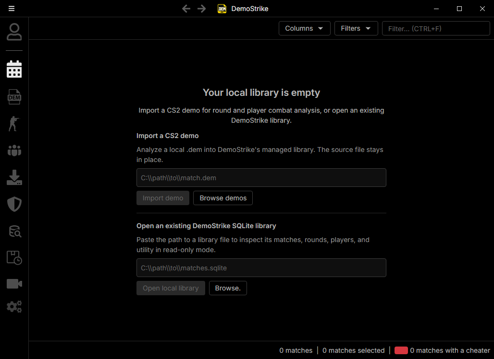

  <picture>
    <source media="(prefers-color-scheme: dark)" srcset="assets/branding/demostrike-header-dark.svg">
    
  </picture>

<h1 align="center">DemoStrike</h1>

  <a href="https://prowebdevsolutions.com"><picture>
    <source media="(prefers-color-scheme: dark)" srcset="assets/branding/PWDS-logo-orange.svg">
    
  </picture></a>

**Find the moments worth clipping.**

DemoStrike turns supported CS2 demos into searchable match events. Review combat, utility, and flashes; mark favorites and tags; then prepare a supervised capture and editable handoff for selected moments.

*Genuine hosted Tauri/WebView2 smoke-build capture of the ported CS Demo Manager renderer with the .DEM file badge. This frame shows an empty library. The application and branding source match this README update. [Capture provenance, launcher distinction and limits](docs/NATIVE_UI_PREVIEW.md).*

## Highlights

- Find and organize events in a local match database.
- Track useful moments with favorites and tags.
- Prepare reviewed capture packages for an editor workflow.

## Current status

Alpha source. The selected renderer is the separate Tauri candidate under `rust-candidate/ported`, built from the pinned full CS Demo Manager application source with native adapters. The repository-root `demostrike` binary still uses the legacy eframe UI; the Tauri candidate is separate from that launcher and is not a released installer.

The selected .DEM identity passed a hosted Windows native build and WebView2 smoke test. The image above comes from that actual selected candidate; this documentation follow-up changes no application or branding source. Older eframe screenshots are retained as [historical previews](docs/NATIVE_UI_PREVIEW.md#historical-eframe-previews). Broad demo compatibility, a new CS2/HLAE capture, human media review, and release packaging remain unverified.

## Capture and editor flow

The in-app path can stage a supervised offline pilot, launch owned CS2/HLAE processes in a bounded Windows Job Object, inspect three camera roles, preview muxed media in the embedded FilmCraft editor, and author a reviewed receipt. Technical QC and media decoding do not mark image, motion, POV or audio as human-approved. Sealing checks source hashes, runtime identity, proof and receipt relationships; the new package sidecar can be verified after relocation. Raw HLAE WAVs, logs and proof PNGs are retained separately for an independent evidence audit. The app does not create footage without external CS2/HLAE tools.

The adapted editor source originated from public [Gerbzz/Clipstrike FilmCraft source](https://github.com/Gerbzz/Clipstrike/commit/4be130f016fe7a0a3b7ae5d59a037c299594aecb). The current [root manifest](Cargo.toml) and [adapted editor manifest](third_party/filmcraft_source/crates/ui-egui/Cargo.toml) pin the unchanged FilmCraft core crates to public commit `a539163b9d86546ba61130c56a0395e05d16d39d`, preserving the dependency fix merged in [PR #12](https://github.com/Gerbzz/DemoStrike/pull/12). Earlier ClipStrike capture crates remain pinned to `fdf2f6ac8828374b803577ae1f6b310b73860075`. These revisions remain in ordinary Git history.

## Source and licensing boundary

This repository contains source and synthetic tests. It excludes demos, captured media, user databases, runtime logs, local paths, compiled binaries, credentials and the private CsThrowBack repository. [SOURCE_SCOPE.md](SOURCE_SCOPE.md) lists the exact boundary. [ATTRIBUTION.md](ATTRIBUTION.md) identifies reused CsThrowBack, FilmCraft and older ClipStrike code and their distinct license status.

There is **no root license grant for first-party DemoStrike source**. Public visibility alone does not set reuse terms. The original FilmCraft MIT/Apache texts and notices are preserved for inherited FilmCraft code; the older public ClipStrike MIT text is preserved for its pinned legacy crates. Those files do not automatically license every DemoStrike adaptation. First-party ownership and redistribution terms require an explicit owner decision before any compiled release.

## Reproduce the source checks

Use a reviewed Windows Rust/Cargo toolchain and the committed lockfile. Populate the Cargo cache with `cargo fetch --locked`, then run `cargo test --locked --offline --lib` and `cargo test --locked --offline --features native-ui --lib` with an isolated target and one Cargo job. The full FilmCraft editor and media graph is substantial; allow enough disk headroom. Real-media tests are intentionally absent from this public source boundary. The normal desktop binary requires the `native-ui` feature.

## Verification history

The earlier local foundation passed 91 no-UI and 112 native-UI library tests, linked the native executable, and passed a generated three-take technical QC/mux exercise. A retained-media editor proof imported a capture, saved and reopened an editable project, and decoded a rendered export. At that earlier checkpoint, the public source snapshot removed match-specific proof tests and identifiers and had not yet been rebuilt. The current identity's hosted validation and screenshot provenance are recorded in [Native UI previews](docs/NATIVE_UI_PREVIEW.md). These checks do not establish broad demo support or human approval of capture quality.

## PWDS brand artwork

The company mark in this masthead is the existing [official PWDS logo](https://github.com/Gerbzz/PWDS-Website/blob/main/public/prowebdevsolutions-logo.png), with the [official orange display asset](https://prowebdevsolutions.com/images/prowebdevsolutions-logo-orange.svg) for dark backgrounds. The .DEM app mark and custom lettering are original DemoStrike artwork; [identity notes](assets/branding/DEM-TACTICAL-IDENTITY.md) describe their source and variants. Historical animal and abstract artwork remains preserved.
